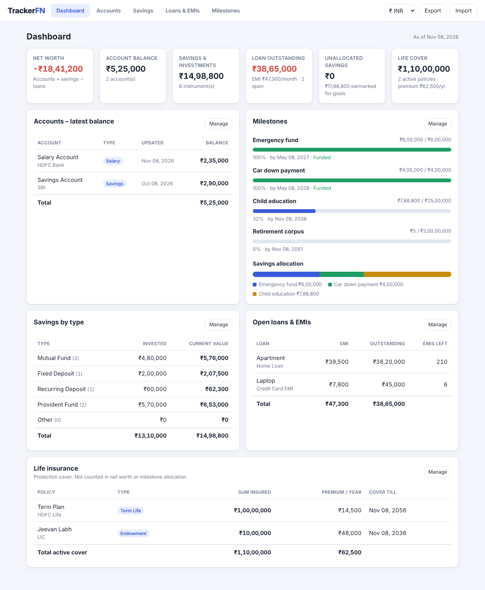

# TrackerFN – Financial Goals Tracker

A simple, dependency-free web app for tracking accounts, savings, loans and financial milestones.
All data stays in your browser (`localStorage`). Nothing is sent to a server.



## Run

Open `index.html` in a browser. There's no build step and nothing to install.
You can also serve the folder, for example with `python3 -m http.server`.

Click **Load sample data** on the empty dashboard to try it out.

## Features

- **Dashboard**: net worth, latest account balances, savings by type, open loans/EMIs,
  milestone progress and how your savings are split across goals.
- **Accounts** (Savings / Salary / Current / Other): add dated balance updates
  (credit, debit, or "set balance to"). The latest balance includes every entry up to today.
  Future-dated entries are shown as scheduled. Full history with a running balance.
- **Savings**: Mutual Funds, Fixed Deposits, Recurring Deposits, Provident Fund and Other.
  Tracks amount invested, current value, gain, rate, monthly contribution and maturity date.
- **Life insurance** (Term, Endowment, ULIP, and others): tracked by **sum insured** and premium, not by amount
  invested. Shown separately on the dashboard as life cover and **not** counted in net worth or
  milestone allocation. Life insurance saved by an older version is moved here automatically;
  enter its sum insured afterwards.
- **Loans & EMIs**: add home loans, credit card EMIs and other loans. Tracks outstanding amount,
  EMI, rate, tenure, end date and EMIs left. Close or reopen a loan, and see your total monthly EMI.
- **Milestones**: set goals with a target amount, target date and priority, then allocate savings
  to them. The pool you can allocate is every savings instrument plus every *Savings* type account.
  - Set allocations per source. You can't allocate more than a source has free.
  - **Auto-allocate** splits the unallocated money by priority, then by nearest target date.
  - Shows progress, amount remaining and the monthly saving needed, and warns when a source's value
    falls below what is allocated from it.
- **Export / Import**: back up to or restore from a JSON file. Choose INR, USD, EUR or GBP.

## Structure

```
index.html        page shell
css/styles.css    styles (light + dark mode)
js/logic.js       calculations only, no DOM (unit-tested)
js/app.js         UI rendering, forms, storage
tests/            node:test unit tests
```

## Tests

```bash
node --test tests/*.test.js
```
